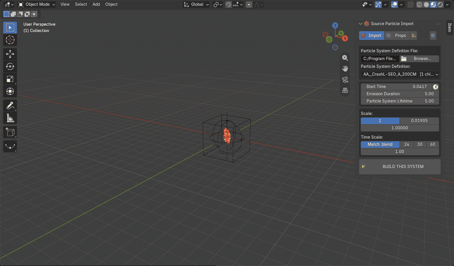
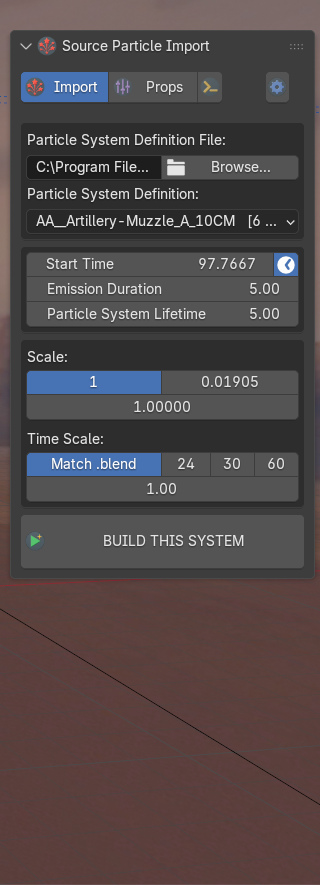
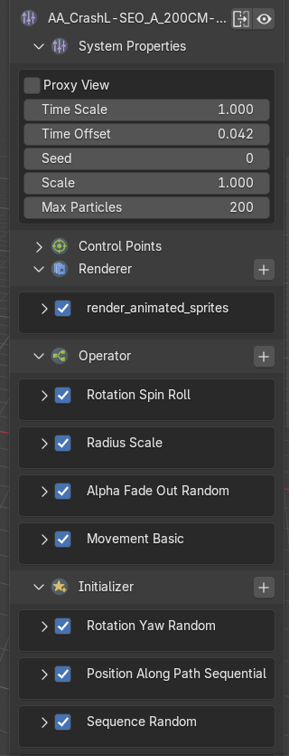
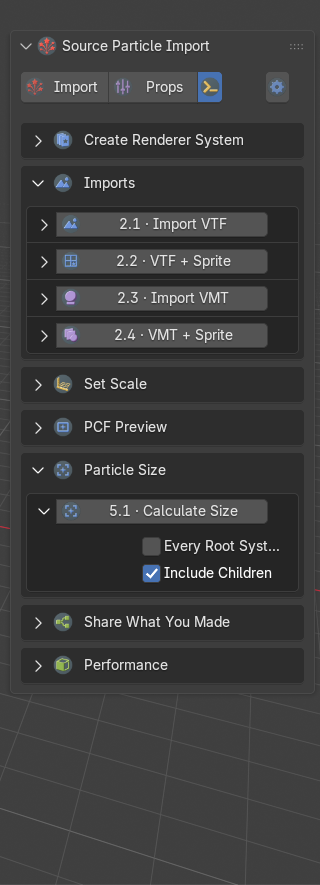
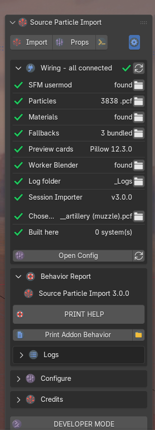
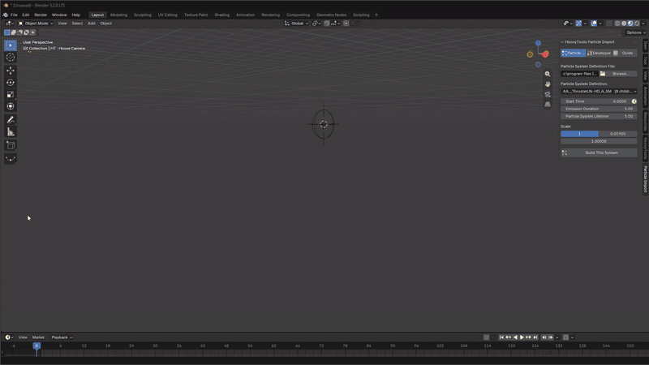
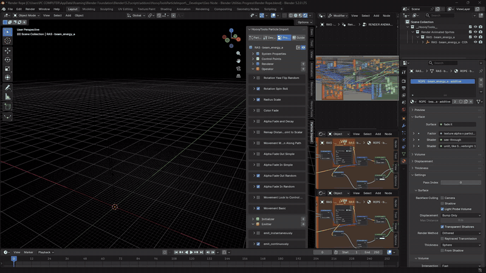

# Source Particle Import
### the particle half of HoovyTools - its twin, [SFM Session Importer](https://github.com/hoovytubeofficial/HoovyTools-SFMSessionImport-Blender), brings the whole session

Source Filmmaker and Source Engine particle effects (`.pcf`) in Blender, as editable geometry-nodes systems. The
two add-ons share one sidebar tab; with the twin installed, a session's effects arrive with the rest of the shot.

*"crash landing - salve - explosive", one of HoovyTube's own effects, built with BUILD THIS SYSTEM and played in
the viewport.*

**Video tutorial:** [Import Particles into Blender](https://www.youtube.com/watch?v=-NGdPxKTsJA) on SourceFilmmakerTube -
and for the twin, [SFM Session to BLENDER Importer](https://www.youtube.com/watch?v=SGEVbgdZYaY).

**[Download 3.0.0](https://github.com/hoovytubeofficial/HoovyTools-ParticleImport-Blender/releases/download/v3.0.0/HoovyTools-ParticleImport-Blender-3.0.0.zip)** - then drag the zip onto Blender. ([All releases](https://github.com/hoovytubeofficial/HoovyTools-ParticleImport-Blender/releases))

Pick a `.pcf`, pick a system, press **BUILD THIS SYSTEM**. The effect arrives with all its child systems, its
materials resolved through the `.vmt` / `.vtf` chain, one control-point rig for the whole effect, and every value the
file authored on a socket you can edit - organised by SFM's own sections: Renderer, Operator, Initializer, Emitter,
Children, Force Generator, Constraint.

Valve's particle editor has outlived several generations of the computers it was written for, and the effects made
with it are still some of the best-looking ones around. They deserve a renderer from this decade.

## What it does

- **Import** - SFM's "Choose Particle System" dialog, in the sidebar and in File > Import > Source Engine (.pcf):
  start time (it follows the playhead while you scrub), emission duration, lifetime, scale in Hammer units or
  metres, and time scale - **Match .blend** reads your scene's frame rate. The build shows its progress, and a scene
  with no camera gets one, framed on the effect's estimated size.
- **Properties** - click a built system and every variable appears in the sidebar, section by section.
- **Tools** - build a renderer by hand from a `.vmt` or `.vtf`, look at textures, set the scale, make preview cards,
  measure an effect, export what you made as a Python script, or swap heavy effects for cheap stand-ins.
- **Dev** - Wiring (is everything found), PRINT HELP (one `.txt` to send when something goes wrong), Configure,
  Credits and Developer Mode.

<table>
<tr>
<td></td>
<td></td>
<td></td>
<td></td>
</tr>
<tr>
<td align="center">Import</td>
<td align="center">Props - the built system's variables</td>
<td align="center">Tools</td>
<td align="center">Dev</td>
</tr>
</table>

### In motion

<table>
<tr>
<td></td>
<td></td>
</tr>
<tr>
<td align="center">Importing an effect (<a href="https://github.com/hoovytubeofficial/HoovyTools-ParticleImport-Blender/releases/download/v3.0.0/pcf-import-demo.mp4">mp4</a>)</td>
<td align="center">Render Rope, at double speed (<a href="https://github.com/hoovytubeofficial/HoovyTools-ParticleImport-Blender/releases/download/v3.0.0/pcf-render-rope.mp4">mp4</a>)</td>
</tr>
</table>

Also: [PCF Preview cards and the node graph](https://github.com/hoovytubeofficial/HoovyTools-ParticleImport-Blender/releases/download/v3.0.0/pcf-preview.mp4) (mp4).

## Install

1. Download `HoovyTools-ParticleImport-Blender-3.0.0.zip` from [Releases](https://github.com/hoovytubeofficial/HoovyTools-ParticleImport-Blender/releases). Leave it zipped.
2. Drag the zip onto any Blender window. Blender offers to install a **Legacy Add-on** - keep *Enable on Install*
   ticked and press OK. (Edit > Preferences > Add-ons > Install from Disk does the same.)
3. In the 3D Viewport, open the sidebar (`N`) > **HoovyTools** > **Source Particle Import**.

The SFM install is found through Steam. If it is somewhere unusual, set it in Dev > Configure, in Edit > Preferences,
or with the LOAD button in Dev > Wiring.

**Requirements:** Blender 4.2 or newer (developed on 5.2) and your own copy of Source Filmmaker - the add-on reads
the `.pcf`, `.vmt` and `.vtf` files there.
**Optional:** [Pillow](https://pypi.org/project/pillow/) in Blender's Python for PCF Preview's cards, and
[SFM Session Importer](https://github.com/hoovytubeofficial/HoovyTools-SFMSessionImport-Blender) to bring in whole
SFM sessions with their particles.

## Quick start

1. **Import** tab > **Browse...** and pick a `.pcf` (the browser starts in `usermod/particles`).
2. Pick a system from the list. `[6 children]` means six more systems ride along with it.
3. Press **BUILD THIS SYSTEM** and scrub the timeline.

## Tutorial: printing a log report

When something goes wrong, one text file tells me what happened. This is how to make it.

1. Open the **Dev** tab - the small gear at the right end of the tab row.
2. Unfold **Behavior Report**. The first line says which version you are on.
3. Press **PRINT HELP**. It writes `__Source Particle Import Log Report Data__ (V1).txt` into the add-on's `_Logs`
   folder and opens the folder. Each press writes the next number, so earlier reports stay.
4. Send that file, with a sentence on what you did and what happened.

It holds what is wrong in plain words, every failure of this session with the `.pcf` it was reading (the file, the
system, the stage, the error and where in the code), the Wiring check, the console, and the newest log file.

> The report contains file paths from your computer, which include your Windows user name. Read it before posting
> it anywhere public.

Inside **Behavior Report > Logs**:

- **Write Log File** keeps everything the add-on prints in `_Logs/Source Particle Import_<date>.log`.
- **Errors** decides how a failure tells you: a **Popup** with the details, the **Status Bar** only, or the
  **Console Only**.
- **Copy Console Output** puts the console on the clipboard, for a quick paste.

Every line the add-on prints starts with `[Source Particle Import]`, so it is easy to find in a busy console.

## Tutorial: the standalone tools

The **Tools** tab (the icon between Props and the gear) works without importing a `.pcf` at all. Each tool is one
row: its name runs it, the arrow on the left unfolds its settings - exactly what the next press will use - and a
symbol on the right says how the last run went.

| Section | Tools |
|---|---|
| 1 Create Renderer System | 1.1 Animated Sprites, 1.2 Rope, 1.3 Sprite Trail - a system built by hand from a `.vmt` or `.vtf` |
| 2 Imports | 2.1 Import VTF, 2.2 VTF + Sprite, 2.3 Import VMT, 2.4 VMT + Sprite - DXT1/3/5 and sprite sheets, no external tools |
| 3 Set Scale | 3.1 Hammer Unit Grid (thin lines, 16 units a square), 3.2 Create Camera |
| 4 PCF Preview | 4.1 one effect, 4.2 a whole folder - preview cards, with folder icons |
| 5 Particle Size | 5.1 Calculate Size - how big an effect gets, read from the `.pcf` without importing it |
| 6 Share What You Made | 6.1-6.4 Node to Code - a built effect or material as a runnable Python script |
| 7 Performance | 7.1 Proxy View - flat stand-ins for heavy effects |

**Calculate Size, step by step:** pick the `.pcf` on the Import tab, open 5 Particle Size, press 5.1 Calculate
Size. The width, depth and height appear under the row, in Hammer units and metres. It is an upper bound -
turbulence and attraction only keep particles closer.

Some tools also come as a **Text Editor version** - a plain script that does the same job:

1. **Dev** tab > **DEVELOPER MODE** (the last button).
2. Unfold 5.1 Calculate Size (or 4.1 Create PCF Preview): a **Text Editor Tool** button appears. It opens the
   folder with `Calculate Particle Size (V1).py`.
3. Open it in Blender's Text Editor, set `PCF_FILE = r"C:\path\to\effect.pcf"` at the top, press
   **Run Script** (`Alt+P`). The sizes print to the system console.

## Version history

- **3.0.0** - this release: the HoovyTools sidebar tab, ribbons for every tool, Calculate Size, Match .blend, the
  automatic camera, the simple Hammer grid, and a Dev tab with Wiring, PRINT HELP and Configure.
- **2.0.0** - the version that was on [hoovytube.com](https://hoovytube.com), published there as 0.23.0. Kept on
  [Releases](https://github.com/hoovytubeofficial/HoovyTools-ParticleImport-Blender/releases/tag/v2.0.0) for
  reference. Install one version at a time.

## Credits

Made by **HoovyTube** - [Patreon](https://www.patreon.com/HoovyTube308) - [Website](https://hoovytube.com) -
[GitHub](https://github.com/hoovytubeofficial/HoovyTools-ParticleImport-Blender), the source of truth for new
versions.

The DMX reader (`tools/datamodel.py`) is by Tom Edwards, from
[Blender Source Tools](https://github.com/Artfunkel/BlenderSourceTools), MIT.

## License

Free for everyone, MIT - see [LICENSE.txt](LICENSE.txt). The three fallback sprites in `materials/` are HoovyTube's
own.

Valve, Source, Source Filmmaker and SFM are trademarks of Valve Corporation. This add-on is not made by or
affiliated with Valve.
